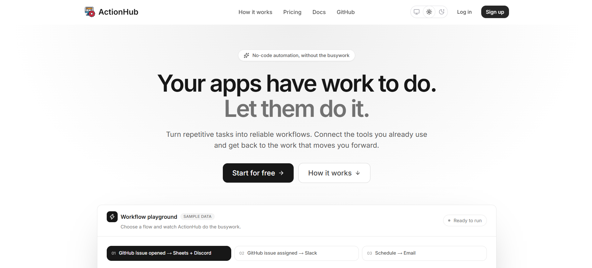
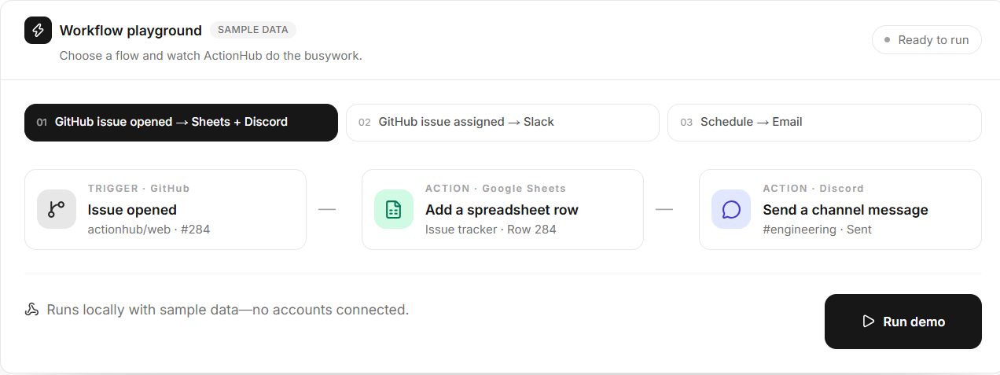
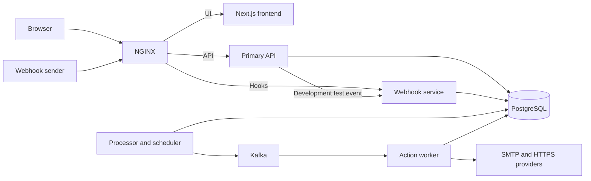
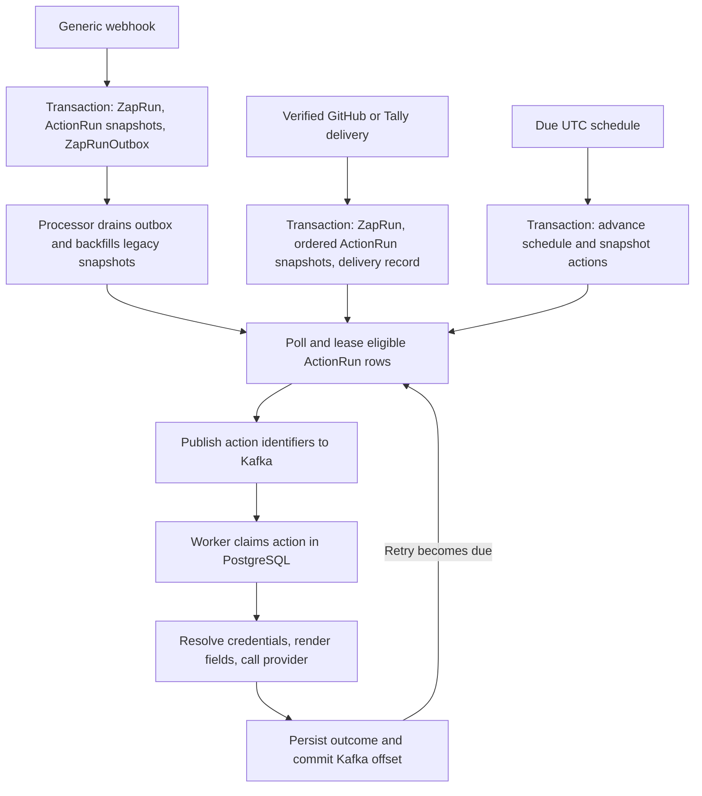
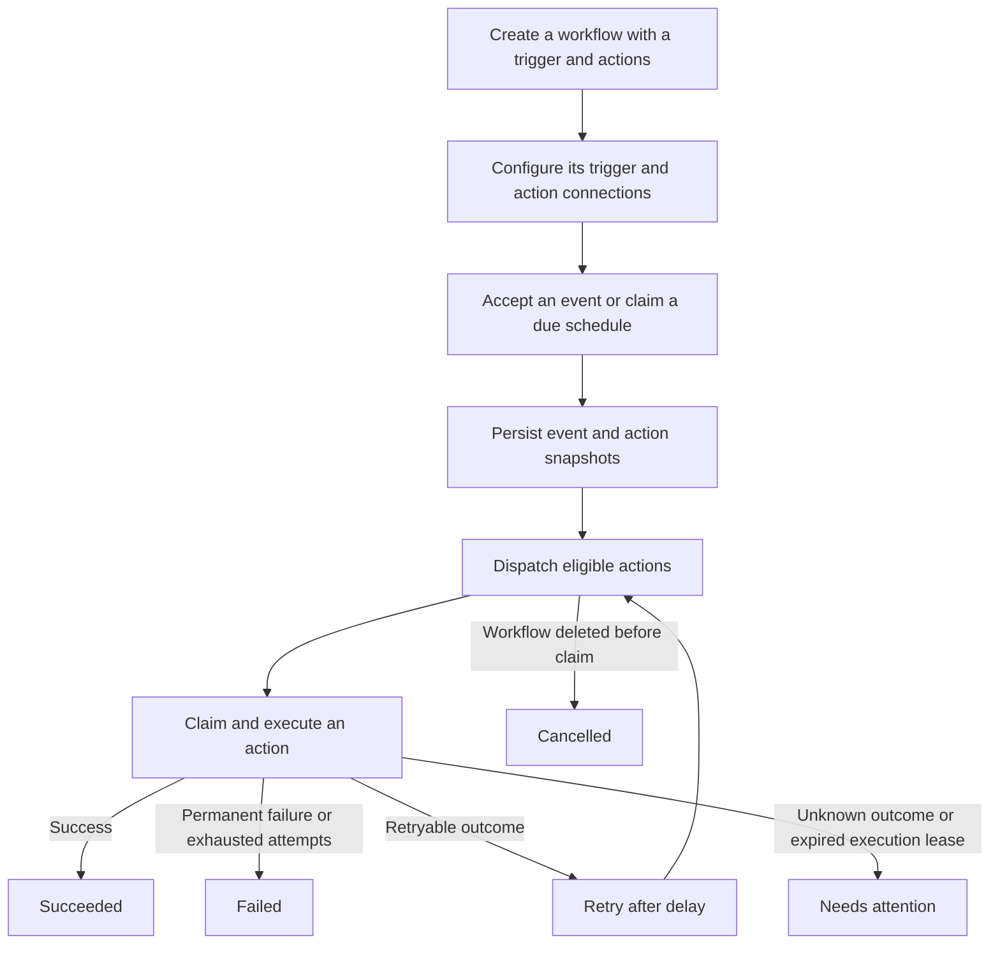

# ActionHub — Open-Source Workflow Automation Platform

[](https://github.com/Jayant9917/Automation-Platform---Zapier-/actions/workflows/ci.yml)

## Overview

ActionHub is a developer-focused, self-hostable workflow automation platform inspired by Zapier and n8n. Define a workflow in the browser, attach a webhook or schedule, and execute saved actions asynchronously. The UI calls these workflows automations. The API and database use the name `Zap`.

## Table of Contents

- [Problem Statement](#problem-statement) · [Key Features](#key-features) · [Screenshots and Demo](#screenshots-and-demo)
- [High-Level Architecture](#high-level-architecture) · [Event Processing Architecture](#event-processing-architecture) · [Workflow Execution Lifecycle](#workflow-execution-lifecycle)
- [Tech Stack](#tech-stack) · [Repository Structure](#repository-structure)
- [Prerequisites](#prerequisites) · [Local Development Setup](#local-development-setup) · [Environment Variables](#environment-variables) · [Docker Setup](#docker-setup)
- [API Documentation](#api-documentation) · [Database Design](#database-design) · [Kafka and Event Processing](#kafka-and-event-processing)
- [Reliability and Failure Handling](#reliability-and-failure-handling) · [Security](#security) · [Testing](#testing)
- [Roadmap](#roadmap) · [Contributing](#contributing) · [License](#license)

## Problem Statement

Small integrations often start as scripts that tie together webhooks, credentials, and external API calls. As integrations grow, developers need a place to configure them, see which steps ran, and distinguish a failed delivery from one with an unknown outcome. ActionHub keeps workflow definitions, incoming events, and action outcomes in PostgreSQL and moves execution off the webhook request path.

## Key Features

- Browser-based workflow editor with a trigger and a list of actions, workflow naming, enable/disable controls, and deletion.
- Generic JSON webhooks, GitHub issue-opened, issue-closed and pull-request-opened events, Tally form submissions, and UTC schedules.
- SMTP email, Slack messages, Discord messages, Google Sheets row appends, and requests to fixed public HTTPS URLs.
- Event-field templates in supported action fields, reusable provider connections, and per-action run history.
- Email/password authentication and optional Google sign-in. The development-only test event button sends a real event through generic webhook ingestion.

## Screenshots and Demo

**Landing page**



**Workflow playground**



The playground on the landing page uses sample data. Its scenarios include GitHub issue assignment, which is outside the implemented trigger catalog.

**Placeholder** — recording of a live workflow run and its Task history.

## High-Level Architecture



The primary API owns accounts, workflow configuration, connections, and history. The webhook service accepts incoming events. The processor enqueues eligible actions and creates due scheduled runs. The worker loads action snapshots, resolves credentials, calls providers, and records outcomes.

## Event Processing Architecture



The transactional outbox is implemented in PostgreSQL. Generic ingestion writes a `ZapRunOutbox` row alongside the run and action snapshots. The processor removes those outbox rows after checking or backfilling snapshots. Pending and retryable `ActionRun` rows serve as the durable dispatch queue across trigger types.

## Workflow Execution Lifecycle



1. Creating a workflow stores its trigger and action definitions. Action edits use a revision to detect concurrent updates.
2. An accepted event stores its payload and snapshots each action's type, configuration, and credential reference. Credentials are resolved at execution time, so revoking a connection can affect queued actions.
3. GitHub, Tally, and scheduled runs snapshot the action sequence. The processor holds later sequenced actions while an earlier action is pending, retrying, or running. A terminal failure allows later steps to proceed. Generic webhook snapshots omit sequence, so their execution order is unspecified.
4. The worker evaluates templates against event metadata and execution identifiers. Task history shows workflow and action outcomes.

## Tech Stack

| Layer              | Implementation                                                |
| ------------------ | ------------------------------------------------------------- |
| UI                 | Next.js App Router, React, TypeScript, Tailwind CSS           |
| API and webhooks   | Node.js, Express, TypeScript, Zod                             |
| Persistence        | PostgreSQL 16 in Compose, Prisma                              |
| Messaging          | Apache Kafka 3.9.1 in Compose, KafkaJS                        |
| Email delivery     | Nodemailer over SMTP, with Resend defaults in Compose         |
| Development and CI | Docker Compose, NGINX, Jest, ESLint, Prettier, GitHub Actions |

## Repository Structure

```text
ActionHub/
├── frontend/         Next.js pages, workflow editor, and Task history
├── primary-backend/  API, Prisma migrations, and catalog seed
├── hooks/            Generic, GitHub, and Tally webhook ingestion
├── processor/        Schedule polling, outbox processing, and Kafka publishing
├── worker/           Kafka consumption, action execution, and providers
├── docker/           NGINX configuration and Docker development tooling
├── .github/          GitHub Actions CI
└── compose.yaml      Local development stack
```

Each application directory has its own `package.json` and npm lockfile. Install dependencies per service.

## Prerequisites

- Git.
- Docker Desktop or Docker Engine with a Compose version that supports Watch. The application images use Node.js 22.
- An authenticated SMTP account and configured sender for the supplied Compose stack. The defaults target Resend.
- Node.js 22 and npm for running services or tests directly. Host-run services also need reachable PostgreSQL and Kafka.

## Local Development Setup

Clone the repository and prepare the Compose environment. These examples use PowerShell.

```powershell
git clone https://github.com/Jayant9917/Automation-Platform---Zapier-.git ActionHub
cd ActionHub
Copy-Item .env.docker.example .env.docker
```

Set `JWT_PASSWORD` to a private random value and `CREDENTIAL_ENCRYPTION_KEY` to 32 random bytes encoded as 64 hex characters. Set `SMTP_PASSWORD` and `SMTP_FROM`. For Resend, use the SMTP API key and a sender on a verified domain.

### Start the full stack

```powershell
docker compose --env-file .env.docker config --quiet
docker compose --env-file .env.docker up --build --watch
```

The build installs each service's dependencies with `npm ci`. Compose starts PostgreSQL and Kafka, creates the Kafka topic, and runs the database initializer. The initializer applies migrations, hashes legacy plaintext passwords, and seeds the trigger and action catalogs. Compose starts the API, webhook service, processor, worker, and frontend and exposes the UI through NGINX.

### Verify a run

1. Open `http://localhost:8080` or use your configured `WEB_PORT`. Sign up and sign in.
2. Create a generic Webhook workflow with an Email action. Use a recipient you control and save the workflow.
3. With `APP_ENV=development` and a non-production Node environment, send a test event from the workflow page. Alternatively, POST JSON to the workflow's catch URL as shown in [API Documentation](#api-documentation).
4. Open Task history and inspect the action status. If delivery fails, review the processor and worker logs.

```powershell
docker compose --env-file .env.docker ps
docker compose --env-file .env.docker logs worker processor
```

### Run services directly

Use independently provisioned PostgreSQL and Kafka reachable from the host. The bundled Compose services advertise internal container addresses. Create `.env` in each backend service from its `.env.example`, use the same database URL in all four services, and create the configured Kafka topic. For front-end development, set `NEXT_PUBLIC_BACKEND_URL=http://localhost:3000` and `NEXT_PUBLIC_HOOKS_URL=http://localhost:3002` in `frontend/.env.local`.

From the repository root, install dependencies and initialize the database.

```powershell
foreach ($service in 'frontend', 'primary-backend', 'hooks', 'processor', 'worker') {
  npm --prefix $service ci
}

Push-Location primary-backend
npm run generate
npx prisma migrate deploy --config prisma.config.ts
npm run migrate:passwords
npx tsx seed.ts
Pop-Location
```

In separate terminals, run `npm run build` followed by `npm start` from each of `primary-backend/`, `hooks/`, `processor/`, and `worker/`. Run `npm run dev` from `frontend/` and open `http://localhost:3001`. The test-event endpoint forwards to the Compose hostname `hooks`. For a direct host run, send the event to the webhook endpoint on port 3002.

## Environment Variables

Use [`.env.docker.example`](.env.docker.example) for Compose and the service-local examples for direct runs. Keep live secrets in ignored environment files.

| Scope                         | Variables                                                                                                                  | Purpose                                                                                                                 |
| ----------------------------- | -------------------------------------------------------------------------------------------------------------------------- | ----------------------------------------------------------------------------------------------------------------------- |
| API, hooks, processor, worker | `DATABASE_URL`                                                                                                             | Connection to the shared PostgreSQL database. Compose supplies it.                                                      |
| API, hooks                    | `PORT`                                                                                                                     | API defaults to 3000; hooks defaults to 3002.                                                                           |
| API                           | `JWT_PASSWORD`, `APP_ENV`                                                                                                  | JWT signing secret and development test-event gate. The gate also checks `NODE_ENV`.                                    |
| API, hooks, worker            | `CREDENTIAL_ENCRYPTION_KEY`                                                                                                | Shared 64-character hex key for encrypted settings and credentials. Keep it stable to preserve access to saved secrets. |
| API                           | `GITHUB_SECRETS`, `GITHUB_SETUP_WORKFLOW_ID`                                                                               | Optional import of a GitHub signing secret for one specific workflow.                                                   |
| API, worker                   | `GOOGLE_OAUTH_CLIENT_ID`, `GOOGLE_OAUTH_CLIENT_SECRET`                                                                     | Optional Google OAuth application credentials. The worker uses them for Sheets token refresh.                           |
| API                           | `GOOGLE_OAUTH_PUBLIC_URL`                                                                                                  | Browser origin used by Google OAuth.                                                                                    |
| API                           | `AUTH_LOGIN_WINDOW_MS`, `AUTH_LOGIN_IP_LIMIT`, `AUTH_LOGIN_ACCOUNT_LIMIT`, `AUTH_SIGNUP_WINDOW_MS`, `AUTH_SIGNUP_IP_LIMIT` | PostgreSQL-backed authentication throttles. The login account limit applies per IP and normalized email pair.           |
| Processor, worker             | `KAFKA_BROKERS`, `KAFKA_TOPIC`                                                                                             | Broker list and shared action topic. Compose uses `kafka:9092` and `zap-events`.                                        |
| Processor                     | `PROCESSOR_BATCH_SIZE`, `PROCESSOR_POLL_INTERVAL_MS`, `SCHEDULER_BATCH_SIZE`                                               | Action batch size, delay between cycles, and due-schedule batch size.                                                   |
| Worker                        | `KAFKA_GROUP_ID`, `WORKER_CONCURRENCY`                                                                                     | Consumer group and number of partitions one worker can handle concurrently.                                             |
| Worker                        | `SMTP_ENDPOINT`, `SMTP_PORT`, `SMTP_USERNAME`, `SMTP_PASSWORD`, `SMTP_FROM`, `SMTP_AUTH`, `SMTP_REQUIRE_TLS`               | SMTP transport and sender. Compose enables authentication and requires TLS.                                             |
| Frontend                      | `NEXT_PUBLIC_BACKEND_URL`, `NEXT_PUBLIC_HOOKS_URL`                                                                         | Browser-facing base URLs. Empty values use the same origin in Compose.                                                  |
| Compose                       | `WEB_PORT`, `KAFKA_PARTITIONS`, `PROCESSOR_REPLICAS`, `WORKER_REPLICAS`                                                    | Loopback gateway port, topic partition count, and service replica counts.                                               |
| Compose                       | `PGADMIN_PORT`, `PGADMIN_EMAIL`, `PGADMIN_PASSWORD`                                                                        | Optional local pgAdmin settings.                                                                                        |

## Docker Setup

The checked-in stack targets development. The gateway binds to loopback and routes `/api/` to the API, `/hooks/` to webhook ingestion, and other paths to Next.js. PostgreSQL and Kafka stay on the Compose network and persist data in named volumes. GitHub and Tally deliveries require a receiver reachable from those providers.

To stop the stack and retain data:

```powershell
docker compose --env-file .env.docker down
```

See the [Docker development guide](docker/README.md) for selective rebuilds, applying new migrations, pgAdmin, scaling, and Google OAuth callback setup.

## API Documentation

Examples use the gateway at `http://localhost:8080`. Send JSON requests with `Content-Type: application/json`. For JWT routes, send `Authorization: Bearer <token>` using the token returned by sign-in. IDs and credentials below are illustrative.

| Method | Endpoint                        | Authentication        | Example                                                         |
| ------ | ------------------------------- | --------------------- | --------------------------------------------------------------- |
| POST   | `/api/v1/user/signup`           | Public, rate-limited  | [Sign up](#sign-up)                                             |
| POST   | `/api/v1/user/signin`           | Public, rate-limited  | [Sign in](#sign-in)                                             |
| POST   | `/api/v1/zap`                   | JWT                   | [Create a workflow](#create-a-workflow)                         |
| POST   | `/hooks/catch/:userId/:zapId`   | Public webhook URL    | [Send a webhook event](#send-a-webhook-event)                   |
| POST   | `/api/v1/zap/:zapId/test-event` | JWT, development only | [Send a development test event](#send-a-development-test-event) |
| GET    | `/api/v1/runs`                  | JWT                   | [Read Task history](#read-task-history)                         |

### Sign up

Request body:

```json
{ "username": "developer@example.com", "password": "example-password", "name": "Developer" }
```

`201 Created`:

```json
{ "message": "Account created. You can now sign in." }
```

### Sign in

Request body:

```json
{ "username": "developer@example.com", "password": "example-password" }
```

`200 OK`:

```json
{ "token": "<jwt>" }
```

### Create a workflow

Request body for a generic webhook with one email action:

```json
{
  "name": "Contact form notifications",
  "availableTriggerId": "webhook",
  "actions": [
    {
      "availableActionId": "email",
      "actionMetadata": {
        "email": "developer@example.com",
        "subject": "New submission",
        "body": "A contact form was submitted."
      }
    }
  ]
}
```

`201 Created`:

```json
{ "zapId": "<workflow-id>" }
```

### Send a webhook event

Use the catch URL displayed by the workflow editor. Substitute the workflow owner's numeric user ID and the workflow ID:

```http
POST /hooks/catch/42/<workflow-id>
Content-Type: application/json

{"source":"contact-form"}
```

`200 OK` means the run was persisted for asynchronous execution:

```json
{ "success": true }
```

### Send a development test event

Send this body to the test-event endpoint for an enabled generic webhook workflow with saved actions:

```json
{ "payload": { "source": "contact-form" } }
```

`202 Accepted`:

```json
{ "success": true }
```

### Read Task history

```http
GET /api/v1/runs?status=succeeded
Authorization: Bearer <jwt>
```

`200 OK` for an account with no workflows or runs:

```json
{ "runs": [], "workflows": [], "nextCursor": null }
```

### Additional API routes

The handlers linked below define the full request validation and response shapes.

| Surface                                                  | Methods and paths                                                                                                                                                 | Authentication                                                                              |
| -------------------------------------------------------- | ----------------------------------------------------------------------------------------------------------------------------------------------------------------- | ------------------------------------------------------------------------------------------- |
| Profile                                                  | `GET /api/v1/user`                                                                                                                                                | JWT                                                                                         |
| [Catalogs](primary-backend/src/router)                   | `GET /api/v1/trigger/available`, `GET /api/v1/action/available`                                                                                                   | Public                                                                                      |
| [Workflow management](primary-backend/src/router/zap.ts) | `GET /api/v1/zap`; `GET`, `PATCH`, `DELETE /api/v1/zap/:zapId`; `PUT /api/v1/zap/:zapId/actions`                                                                  | JWT                                                                                         |
| [Trigger setup](primary-backend/src/router/zap.ts)       | `GET` and `PUT` on `/api/v1/zap/:zapId/schedule`, `/api/v1/zap/:zapId/github-trigger`, and `/api/v1/zap/:zapId/tally-trigger`                                     | JWT                                                                                         |
| [Run history](primary-backend/src/run-history.ts)        | `GET /api/v1/runs/:runId`, `GET /api/v1/zap/:zapId/runs`                                                                                                          | JWT                                                                                         |
| [Connections](primary-backend/src/connections.ts)        | `GET` and `POST /api/v1/connections`; `PUT` and `DELETE /api/v1/connections/:connectionId`                                                                        | JWT                                                                                         |
| [Google OAuth](primary-backend/src/index.ts)             | Under `/api/v1/oauth/google`: `GET /capabilities`, `POST /login/start`, `POST /:purpose/start`, `GET /:mode/callback`, `POST /session`, `GET /attempt/:attemptId` | JWT for purpose start and attempt status; callbacks and session exchange validate flow data |
| Provider webhooks                                        | `POST /hooks/github/:workflowId`, `POST /hooks/tally/:workflowId`                                                                                                 | Provider HMAC signature                                                                     |
| Service health                                           | `GET /health` on the API and webhook service ports                                                                                                                | Public on those services                                                                    |

## Database Design

[Primary backend schema](primary-backend/prisma/schema.prisma) and [migration history](primary-backend/prisma/migrations) define the shared database used by Compose. The other services carry Prisma schema copies for their generated clients.

| Models                                                              | Role                                                                                |
| ------------------------------------------------------------------- | ----------------------------------------------------------------------------------- |
| `User`, `AuthRateLimit`, `GoogleOAuthFlow`                          | Identity, authentication throttles, and OAuth flow state                            |
| `Zap`, `Trigger`, `Action`, `AvailableTriggers`, `AvailableActions` | Owned workflows, definitions, and seeded catalogs                                   |
| `Credential`, `GithubTrigger`, `TallyTrigger`, `ScheduleTrigger`    | Provider connections, webhook settings, and schedule cursors                        |
| `ZapRun`, `ActionRun`, `ZapRunOutbox`, `LegacyJob`                  | Event payloads, action snapshots and outcomes, outbox records, and legacy job state |
| `GithubDelivery`, `TallyDelivery`                                   | Provider delivery identity and payload hash for deduplication                       |

Action snapshots are unique per run and action. Workflow deletion retains historical runs and cancels pending or retrying actions. An action claimed before deletion can finish.

## Kafka and Event Processing

The processor publishes versioned jobs of the form `{version: 1, executionId, actionExecutionId}` to `zap-events` by default, using the action execution ID as the Kafka key. The worker group defaults to `main-worker`. The message carries identifiers; the worker reads configuration and credentials through PostgreSQL.

Workers manually commit the next offset after handling a message. Invalid messages are logged and skipped. A compatibility path handles legacy email jobs. Consumer capacity is constrained by partition count, and the database enforces ordering for sequenced actions across partitions.

## Reliability and Failure Handling

- **Dispatch recovery.** A 30-second dispatch lease limits duplicate publication. Eligible rows can be republished after the lease expires, including after a publish error.
- **Execution claims.** The worker atomically claims an eligible action before side effects. Duplicate Kafka messages can reach the worker; only a successful claimant executes the action.
- **Retries.** The worker allows up to three attempts for retryable outcomes, with exponential delays starting at 10 seconds and support for bounded provider retry hints. A permanent error or exhausted retry budget ends in `failed`.
- **Ambiguous outcomes.** An expired worker lease or unknown provider outcome goes to `needs_attention` for review. Delivery to external systems has no exactly-once guarantee.
- **Trigger deduplication.** GitHub delivery IDs and Tally submission IDs are scoped to the workflow. Matching repeat deliveries are acknowledged, and conflicting payload hashes return `409 Conflict`. The scheduler conditionally advances a due slot in the same transaction as run creation. Repeated generic webhook requests can create separate runs.

## Security

- Passwords use salted scrypt hashes. The API verifies 12-hour HS256 JWTs and scopes workflow, connection, and run access to the authenticated owner. PostgreSQL backs login and signup throttles.
- Provider credentials use AES-256-GCM. Keep the shared encryption key private and stable. The worker checks credential ownership, provider, and revocation before use.
- GitHub verifies `X-Hub-Signature-256` against raw request bytes. Tally verifies `Tally-Signature` against the parsed payload serialized as JSON. The generic catch URL accepts events without a signature. Share it only with intended senders.
- The HTTP action requires a fixed public HTTPS URL, validates and pins DNS resolution to a public IPv4 address, and blocks redirects.

## Testing

From a service directory with dependencies installed, run:

```sh
npm run test:unit
npm run test:ci
```

CI checks all five services for lint, formatting, Jest coverage, TypeScript, and production builds. Unit tests mock external boundaries and run in network-isolated containers in CI. Use the [manual workflow check](#verify-a-run) to exercise Compose, Kafka, PostgreSQL, and SMTP together.

## Roadmap

No release roadmap is published. Previously listed follow-up areas include integration tests and additional trigger and action types. Scope and release dates are open.

## Contributing

Open an issue for behavior changes or submit a pull request with a reproduction, the affected service, and verification results. For schema changes, update the migration history in `primary-backend/` and keep affected Prisma schema copies aligned. See [CONTRIBUTING.md](CONTRIBUTING.md) for the checks expected before opening a pull request.

## License

The backend service manifests list ISC. A standalone repository license file is pending confirmation from the maintainers.
